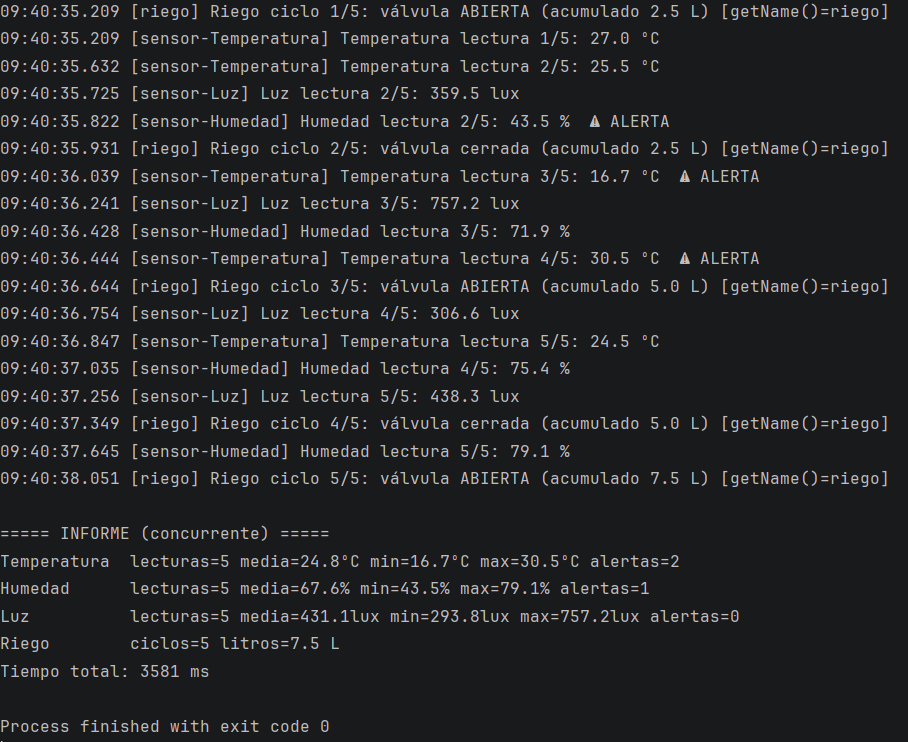

# psp-ud4-invernadero

# Invernadero con hilos

> Práctica UD4 · Programación de Servicios y Procesos · 2.º DAM · Davante MEDAC Sevilla Este
> Autor: **Mauro Rodríguez Ponce**

## Qué hace
Automatiza un invernadero simulando cuatro dispositivos que trabajan a la vez, cada uno en su propio hilo:

| Dispositivo | Cada | Valores que genera | Rango correcto | Implementación |
|---|---|---|---|---|
| Sensor de temperatura | 400 ms | 15,0 – 35,0 ºC | 18 – 30 ºC | `Runnable` |
| Sensor de humedad | 600 ms | 40,0 – 90,0 % | 50 – 80 % | `Runnable` |
| Sensor de luz | 500 ms | 0 – 1000 lux | 200 – 900 lux | `Runnable` |
| Programador de riego | 700 ms | abre / cierra la válvula | — | `extends Thread` |

Cada sensor toma 5 lecturas y muestra `⚠ ALERTA` si la lectura sale de su rango. El riego hace 5 ciclos (abre, cierra, abre, cierra, abre) y riega 2,5 L cada vez que abre (3 aperturas = 7,5 L). Al final se imprime un informe con las estadísticas de cada objeto (lecturas, media, mínimo, máximo y alertas).

Solo se usan `Thread` y `Runnable` (sin `ExecutorService`, pools ni hilos virtuales). Cada objeto guarda sus propias estadísticas en atributos de instancia (nada `static`).

## Cómo ejecutarlo
1. Abrir el proyecto en IntelliJ IDEA con JDK 21 (`src` como *Sources Root*).
2. Ejecutar el `main` de cada clase `Fase…` (botón ▶). Las cuatro terminan solas.
   Por terminal:
```bash
javac -encoding UTF-8 -d out src/*.java
java -cp out Fase2_Concurrente
```

## Captura



Captura de consola de una ejecución de la Fase 2 (`Fase2_Concurrente`): el informe sale completo (5 lecturas por sensor y 5 ciclos de riego) y solo después de que terminen los cuatro hilos.

## Resultados

Tiempos medidos en mi equipo con `System.currentTimeMillis()` al principio y al final de cada versión:

| Versión | Tiempo medido | Tiempo teórico | Diferencia |
|---|---|---|---|
| Fase 1 · secuencial (`run()` desde `main`) | **11 192 ms** (≈ 11,2 s) | 2000 + 3000 + 2500 + 3500 = **11 000 ms** (suma) | +192 ms |
| Fase 2 · concurrente (`start()` + `join()`) | **3 581 ms** (≈ 3,6 s) | máx(2000, 3000, 2500, 3500) = **3 500 ms** (el riego) | +81 ms |

La versión concurrente tarda unos 7,6 s menos (≈ 68 % menos): es **3,1 veces más rápida**.

Cómo salen los tiempos teóricos: cada dispositivo tarda `lecturas × periodo`, porque duerme su periodo después de cada lectura:

| Dispositivo | Periodo | Lecturas / ciclos | Tiempo del dispositivo |
|---|---|---|---|
| Temperatura | 400 ms | 5 | 2000 ms |
| Humedad | 600 ms | 5 | 3000 ms |
| Luz | 500 ms | 5 | 2500 ms |
| Riego | 700 ms | 5 | 3500 ms |

## Análisis

### ¿Por qué compensa usar hilos en el invernadero?
Los cuatro dispositivos pasan casi todo su tiempo dormidos en `Thread.sleep`, esperando a su siguiente periodo. En secuencial esas esperas se suman (11 s) y, mientras se espera a la humedad, nadie vigila la temperatura. Con un hilo por dispositivo las esperas se solapan y el programa dura lo que el dispositivo más lento (3,5 s): unas **3 veces menos** y todos los sensores se vigilan a la vez. Compensan porque el trabajo es de *espera* (como el de un sensor real que espera datos); no ganaríamos tanto en un cálculo puro de CPU, y además hay que pagar el coste de crear hilos y, si compartieran datos, de sincronizarlos (UD6). Aquí no se comparte nada: cada hilo escribe solo en sus propias estadísticas y `main` las lee después del `join()`, que garantiza que ya están completas.

**Fase 1 · ¿qué nombre de hilo aparece en todo el log?** Siempre `main`. Llamar a `run()` es llamar a un método normal: lo ejecuta el hilo que lo llama, es decir, `main`. No se crea ningún hilo nuevo.

**Fase 2 · ¿sale siempre en el mismo orden el log?** No. Los hilos arrancan casi a la vez y el planificador decide cuál escribe primero: en mis ejecuciones la primera línea fue `sensor-Temperatura` unas veces y `sensor-Luz` otras. Lo que sí se mantiene es el orden *dentro* de cada hilo (lectura 1, 2, 3…) y, a grandes rasgos, el ritmo de cada periodo.

### Experimentos A, B y C

- **A · informe sin esperar.** La primera vez el informe sale **«sin lecturas todavía»** (0 lecturas). `start()` no bloquea: `main` sigue con la línea siguiente y pide `informe()` antes de que el hilo `sensor-Temperatura` haya hecho ni la primera medición. Después de `join()` sale completo (5 lecturas, media, mín., máx. y alertas). El log de las lecturas muestra siempre el hilo `sensor-Temperatura`.
- **B · `run()` en vez de `start()`.** En el log el hilo es **`main`**, aunque `getName()` del objeto diga `riego`: ese nombre pertenece al objeto `Thread`, pero quien ejecuta el código es `main`. Tardó ≈ 2104 ms (3 ciclos × 700 ms), o sea, secuencial: no hay concurrencia. `getState()` da **`NEW`** porque nunca se arrancó un hilo real: `run()` es un método ordinario y el objeto `Thread` jamás pasó por `start()`.
- **C · doble `start()`.** Salta **`java.lang.IllegalThreadStateException`**, que capturo y muestro. Significa que el hilo no está en un estado válido para arrancar: un `Thread` solo puede arrancarse **una vez**; tras terminar queda en `TERMINATED` y no vuelve a `NEW`. Para repetir la tarea hay que crear otro objeto `Thread`. (El log del primer arranque aparece con el hilo `riego`.)
### Estados observados (estado · cuándo · qué línea lo provoca)

| Estado | Cuándo | Línea que lo provoca |
|---|---|---|
| `NEW` | Antes de arrancar (primera foto de `main`) | Los hilos están creados (`Fase4_Vigilante` l. 9–11 y `new ProgramadorRiego()`) pero aún no hay `start()` |
| `RUNNABLE` | Justo tras arrancar, y un instante en cada lectura | `start()` en `Fase4_Vigilante` l. 27–30; el hilo ejecuta código (medir, imprimir) |
| `TIMED_WAITING` | La mayor parte del tiempo, entre lecturas / ciclos | `Thread.sleep(periodoMs)` en `Sensor` l. 42 y `Thread.sleep(PERIODO_MS)` en `ProgramadorRiego` l. 30 |
| `TERMINATED` | Cuando cada hilo acaba (temperatura a los 2 s, luz 2,5 s, humedad 3 s, riego 3,5 s) y los cuatro tras esperarlos | Termina `run()`; `main` lo comprueba tras los `join()` (l. 33–36) |
| `WAITING` | **No aparece** | Solo se da con `join()` o `wait()` *sin tiempo* dentro de los hilos vigilados. El único `join()` lo hace `main`, que no está entre los vigilados; los hilos vigilados usan `sleep(ms)`, que es `TIMED_WAITING` |
| `BLOCKED` | **No aparece** | Exige competir por un cerrojo (`synchronized`); no hay ninguno: cada hilo trabaja con sus propios datos (se verá en UD6) |

**¿Por qué termina el programa si el vigilante sigue en su bucle?** Porque el vigilante es un hilo **demonio**: `vigilante.setDaemon(true)` (l. 24), llamado **antes** de `start()` (después da `IllegalThreadStateException`). La JVM termina cuando solo quedan hilos demonio vivos y no los espera. Cuando `main` pasa los cuatro `join()` y acaba, solo queda el vigilante, con su `while (true)` (l. 15), y la JVM lo mata. Si no fuera demonio, el bucle infinito mantendría vivo el programa y habría que pararlo a mano.

### Thread frente a Runnable

| Aspecto | `extends Thread` | `implements Runnable` |
|---|---|---|
| Qué representa el objeto | El **hilo** (y la tarea a la vez) | Solo la **tarea**; el hilo es otro objeto (`new Thread(tarea)`) |
| Cómo se arranca | `riego.start()` directamente | `new Thread(sensor, "nombre").start()` |
| Nombre del hilo | `super("riego")` en el constructor y `getName()` | No tiene `getName()`: se pasa al crear el `Thread` y se lee con `Thread.currentThread().getName()` |
| Herencia | Consume la única herencia de Java | Libre: se puede heredar de otra clase (`Sensor`) |
| Reutilización | Un objeto solo se arranca una vez (experimento C) | La misma tarea puede pasarse a varios `Thread` |
| Separación | Mezcla «qué hacer» con «cómo ejecutarlo» | Separa la tarea del mecanismo de ejecución |

**¿Por qué los sensores SOLO pueden ser Runnable en mi diseño?** Porque `Temperatura`, `Humedad` y `Luz` ya heredan de la clase abstracta `Sensor`, donde está todo lo común (atributos, `run()`, estadísticas, `informe()`), y Java solo permite **una** superclase. Si hicieran `extends Thread` no podrían heredar de `Sensor` y habría que duplicar ese código en las tres clases. Con `Runnable` la herencia queda libre para `Sensor`, y es `Fase2_Concurrente` quien decide ponerles hilo y nombre (`new Thread(t, "sensor-Temperatura")`).

**¿Qué forma elegiría para el riego y por qué?** En esta práctica el enunciado pide `extends Thread` y encaja: `ProgramadorRiego` no hereda de nada más, quiere nombre propio (`riego`) y se arranca directamente con `start()`. En un diseño propio elegiría `Runnable`: separa la tarea del hilo, deja libre la herencia, evita el error de llamar a `run()` o `start()` dos veces sobre el mismo objeto y facilita cambiar más adelante cómo se ejecuta.

### Conclusión: cuándo compensan los hilos
Compensan cuando hay tareas independientes con mucha espera (sensores, red, disco): el tiempo total baja de la suma al máximo, como se comprobó (11,2 s → 3,6 s). No compensan en tareas muy cortas o de CPU pura, o cuando comparten muchos datos, porque el coste de crear hilos y sincronizarlos se come la ganancia. Además, con hilos el orden del log deja de ser fijo y hay que esperar (`join()`) antes de usar resultados.